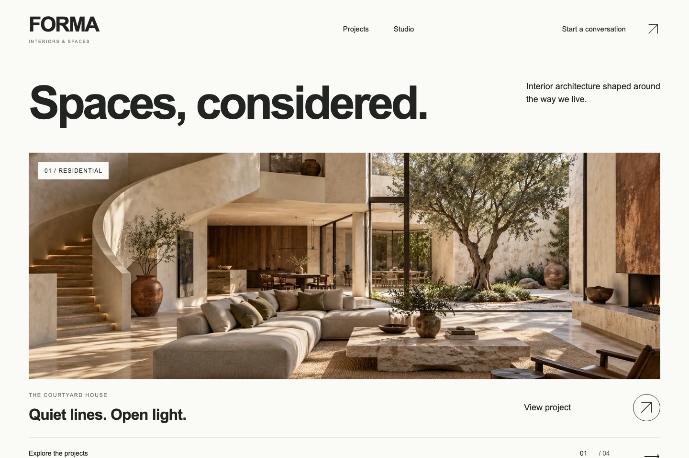

# FORMA — Spaces, considered.

An original fictional architecture and interiors portfolio created in **November 2026**. Four imagined spaces explore light, material and everyday rituals through a spacious editorial interface.



[Source](https://github.com/khalilBenAli1/forma-astro) · [Quality checks](https://github.com/khalilBenAli1/forma-astro/actions) · [Architecture](docs/ARCHITECTURE.md) · [Asset provenance](ASSETS.md)

**[Open the live demo](https://khalilbenali1.github.io/forma-astro/)** — verified on GitHub Pages in Chromium and WebKit. [Delivery evidence](docs/DELIVERY.md).

## Explore

- A photographic homepage, studio page and four complete project narratives.
- Residential, hospitality, workplace and cultural collection filters with URL state, Back/reload support and empty-result recovery.
- Prerendered case studies, meaningful related links and responsive original concept imagery.
- A keyboard gallery with arrow navigation, wrapping, consistent Tab containment, Escape and restored focus. Full-image links work without JavaScript.
- Native mobile navigation and reduced-motion support.
- A validated **local enquiry preview**. It sends and stores nothing; use sample details. “Try another enquiry” resets it. Without JavaScript the submission control stays disabled.
- Page-specific metadata, canonical URLs, sitemap, social preview and a deliberate 404.

**These are fictional design studies, not built client commissions.** There are no fabricated testimonials, awards, commercial metrics, external enquiries or real customer records. Each study has one original image; gallery details are explicitly labelled crops of that same image.

## Run locally

Use Node **22.23.4** and npm **10.9.8**. Astro 7.4.5 requires this Node patch or newer. Dependencies and the package manager are pinned; no API keys or accounts are needed to try the application.

```sh
nvm install
npm install --global npm@10.9.8
npm ci
npm run dev
```

Open `http://127.0.0.1:4184/forma-astro/`. To inspect production output, run `npm run build` then `npm run preview`.

## Verify

```sh
npm run lint
npm run format:check
npm run typecheck
npm test
npm run build
npx playwright install chromium webkit
npm run test:e2e
node scripts/measure-build.mjs
```

The unit tests exercise the real content schema, related IDs, distinct cover imagery, invalid content rejection and enquiry validation boundaries. The **16 Playwright journeys** run in Chromium and WebKit, including filtering/back/reload, gallery keyboard/focus behavior, mobile navigation, contact validation/success/reset, static no-JavaScript navigation, approved layout geometry, and maximum-length contact input, and every route's accessibility/reflow against `documentElement.clientWidth` at **320, 390, 768 and 1440px**. CI installs browser dependencies, repeats the frozen-lockfile checks and deploys main only after success.

Actual screenshot evidence: [short interaction walkthrough](docs/screenshots/forma-walkthrough.webm), [desktop home](docs/screenshots/home-desktop.png), [mobile home](docs/screenshots/home-mobile.png), [project index](docs/screenshots/projects-desktop.png), [case study](docs/screenshots/project-desktop.png), [contact](docs/screenshots/contact-desktop.png). The reference comparison scored 94/100; this is an internal visual review, not a performance or accessibility certification.

## Implementation

**Astro 7.4.5 · strict TypeScript 6.0.3 · content collections · Zod · plain CSS**. No React/Vue runtime, client router, global store, backend, database, analytics or third-party form service. Pages compose focused collection, gallery and enquiry features; the validator is pure TypeScript. Temporary UI state stays local, and contact data is never persisted. See [architecture and data flow](docs/ARCHITECTURE.md) and [measured payloads](docs/PERFORMANCE.md).

GitHub Actions uses immutable official action SHAs and minimal permissions. GitHub Pages receives static directory routes under `/forma-astro/`. The explicit npm pin and AJV development peer pin keep clean installation deterministic; the minimatch override applies its current advisory fix.

## Scope and licenses

Original code uses [MIT](LICENSE); dependencies retain their own licenses. [ASSETS.md](ASSETS.md) documents generated imagery, provenance and prompts. Typography pairs self-hosted Archivo display type with IBM Plex Sans interface text; their SIL OFL licenses are included. AI artwork is conceptual and may contain architectural imperfections.

The WCAG 2.2 AA target is supported by automated Axe and keyboard checks, without claiming certification. Physical mobile hardware and screen-reader testing remain outside the verified scope. The enquiry form intentionally has no delivery backend.
